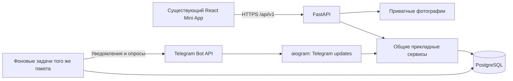

# Архитектура backend «Пойдём?»

**D69 / развёртывание:** [отдельный production Compose и эксплуатация](PRODUCTION_DEPLOYMENT.md). Архитектура приложения прежняя: один FastAPI с cleanup/archive loops, один aiogram polling+outbox, PostgreSQL17 и приватный media volume API/ops. Разовые migrator/Certbot/backup не являются новыми постоянными бизнес-сервисами. Один HTTPS-origin Nginx; только80/443 наружу, head0014/39 таблиц прежние

**D67 / этап 11В — актуальные требования:** свободные название/адрес без предварительного одобрения; необязательная проверка точной версии места, 0014/39 таблиц. Каталог D66 и исторические адреса сохранены, но не блокируют публикацию. Репутация — три независимых положительных признака, прежние фото/встречи + добровольные впечатления разных партнёров; старые приватные оценки не используются. [Устройство, формулы и API](FREE_PLACES_REPUTATION_STAGE11V.md)

**D66 / предыдущая реализация:** собственный каталог общественных мест без 2ГИС/внешних ключей, ручная модерация/CSV/0013 (38 таблиц), исторические адреса сохранены. Фотоверификация — компактный UI без изменения backend-проверки. Это заменяет прежние условия внешнего Places API. [Реализация, API и запуск](LOCAL_PLACES_AND_VERIFICATION_UX.md)

**D65:** тот же FastAPI/PostgreSQL, services/photo_verification.py, schemas/verification.py, api/routers/photo_verification.py, одна таблица и photo_revision Profile. Reuse Pillow/MEDIA_ROOT/MediaDeletion/orphan scan/admin_permissions/AdminAuditLog/notification_jobs; никакой новой инфраструктуры и пользователей. [Архитектура проверки фото](PHOTO_VERIFICATION_STAGE11B.md)

**D62:** тот же монолит расширен services/admin_permissions.py, admin_team.py, editorial.py, admin_system.py и bot_health.py; routes/admin_management.py. Роли в прежнем User, редакционные идеи PostgreSQL вместо статического frontend-массива, минимальные heartbeat в том же bot/worker. Миграция 0010, без второй админки, очереди, пользователей или внешней инфраструктуры. [Архитектура и права](ADMIN_STAGE9B.md)

D55: модуль services/safety.py и api/routers/safety.py расширяют прежний монолит для жалоб, персональных блокировок и закрытой модерации. Роли прежних User, сессия/CSRF прежние, административный frontend — /admin в том же React. Миграция 0008 меняет прежние таблицы; notification_jobs остаётся единственной очередью. B06/B11 уточнены заданием этапа 7 в рамках [SAFETY_STAGE7](SAFETY_STAGE7.md); санкции/апелляции/B10/B13 не согласованы

D53 / этап 6: Bot API polling и outbox worker запускаются одним процессом того же Python-проекта, без нового сервера/брокера/БД. API только пишет durable jobs вместе с событием; сеть — вне транзакции, lease/fencing и сериализация получателя в PostgreSQL. B09 отдельно утверждён пользователем; feedback не превращается в рейтинг/доказанный факт. [Реализованный объём](BOT_STAGE6.md)

D51: существующий API дополнен серверными viewer_role и минимальным неизменяемым контекстом отклика; accepted включает свой MatchDTO. Новых endpoints/систем пользователей нет. Уточнение сохраняет Telegram-сессии, транзакции D50, чат, фон архива и лимиты. [Отчёт UX/API](CARDS_UX_REVIEW.md)


D50: дополнение этапа 5 реализовано внутри того же FastAPI/PostgreSQL. Чат: ChatThread на Match, ChatMessage с последовательностью и ключом повтора, ChatReadState; HTTP polling без WebSocket/брокера. Архив: идемпотентный фоновый цикл FastAPI (60 секунд), чтения применяют то же временное условие без ожидания цикла. «Все» — серверный UNION ALL с keyset-пагинацией по приоритету/времени/UUID. [Подробности](CHAT_ARCHIVE_STAGE5.md). B05 уточнён: 15 ожидающих, rejected окончательный, слот другим людям. B08: встроенный чат основной, Telegram username необязателен


Этап 5 / D49: B03 закрыт единственной парой на план. B05 уточнён пользователем: до 15 ожидающих, отказ освобождает слот для повторной попытки/нового человека. B08 решён для текущего объёма ссылкой по последнему подтверждённому username с честным отсутствием контакта. Использованы существующие таблицы/сессии/файловое хранилище и миграция 0004. [Реализация, API, тесты и остающиеся вопросы](MATCHES_STAGE5.md). Нижний реестр B сохраняет исходные вопросы, их актуализация определяется D49.

Актуализация этапа 4: ручной Telegram-прогон на двух аккаунтах завершён успешно по подтверждению пользователя. На прежней архитектуре реализуются реальные планы; утверждённые правила D46, API/схема и запуск — [PLANS_STAGE4](PLANS_STAGE4.md). Демо не возвращается. B04 закрыт для текущих операций московскими сутками/расходом при первом сохранении/без возврата; до B13 удаление аккаунта с планами/историей остаётся заблокировано. Для B06 согласована только явная публикация после фильтра с not_submitted; полноценный workflow не придуман. Редактирование/отмена до откликов разрешены, при связях — 409. Старый аудит ниже описывает предыдущий этап.

Текущее дополнение D43: DemoProvider/AppDataProvider/data/demo.ts удалены. Корневой frontend монтирует только ApiProvider, useAppData предоставляет серверную анкету и временные черновики. Фиктивных публикаций/анкет/мэтчей/переключателей нет. Редакционные идеи — data/editorial.ts, общие коды — data/catalogs.ts. Предыдущий аудит о наличии деморежима ниже исторический.

Дата: 20.11.2026. Реализованы каркас 3.2 и Telegram-вход/собственная анкета 3.3–3.4. Текущая реализация и настройки — [TELEGRAM_AUTH](TELEGRAM_AUTH.md), команды — [backend/README](../backend/README.md). Настоящие планы/мэтчи, бот и admin UI ещё не реализованы. HTTPS-проверка на устройствах отложена до подготовки доступа к локальному API. Commit, push и деплой не разрешены.

Аудит и проект запуска ниже сохраняются как история этапа 3.0, а не описание отсутствующих сейчас файлов. Текущие ApiProvider/ApiClient подключают прежнюю форму к защищённому API; демонстрационного провайдера больше нет, реальные данные не берутся из localStorage. Локальные dev proxy и API работают на 5173/8001. Конфигурация Pages не менялась; /api там потребует отдельного проксирования.

Связанные документы: [контракт API](API_CONTRACT.md), [схема данных](DATABASE_SCHEMA.md), [безопасность](SECURITY.md), [последовательность реализации](ROADMAP.md). Здесь находится основной реестр открытых серверных решений B01–B14; прежние Qxx из [DECISIONS](DECISIONS.md) сохраняют историю требований.

## 1. Подтверждено и предложено

Подтверждено последним заданием: существующий React/TypeScript, FastAPI, PostgreSQL, SQLAlchemy 2, Alembic, aiogram, pytest, Docker Compose; все 13 перечисленных функций, включая защищённую административную панель. Сохраняются ограничения 3 создания в день, 15 разных откликнувшихся, парный мэтч после согласия автора, жалобы/блокировки и неизвестные пока два этапа модерации. Данные Telegram проверяет сервер. Реальные данные не берутся из localStorage.

**Предложения этого проекта**, требующие принятия перед соответствующей реализацией: структура Python-пакета, процессы API/bot/worker, opaque cookie-сессия, конкретные HTTP-маршруты, таблицы, приватный файловый volume для фотографий, двухролевой старт user/admin, версии инструментов и способ размещения API. Таблицы/JSON ниже не являются действующими миграциями/OpenAPI. Нераскрытые бизнес-правила не выбраны вместо заказчицы.

## 2. Аудит существующего репозитория

Проверены структура репозитория, текущие документация, страницы/компоненты, состояние, типы, правила, SDK-мост, конфигурация и браузерные тесты. В репозитории нет Python-приложения, миграций, Compose, API-клиента или работающей административной панели. `frontend/vite.config.ts` содержит только React-плагин; прежний вариант с двумя сборками отменён. Pages сейчас обслуживает статический frontend из `frontend/dist`.

| Найдено | Значение для реального MVP |
| --- | --- |
| `src/main.tsx` всегда подключает `DemoProvider` | Нужен выбор отдельного источника данных; сетевые ошибки не должны включать демо |
| `state/DemoProvider.tsx`, `state/context.ts` | Здесь находятся все локальные действия: анкета, план, публикация, выбор, отклик, принятие, сброс и квоты |
| `lib/storage.ts` | `poidem:demo:v1` — обычная локальная анкета/черновики, несмотря на имя ключа; `poidem:simulation:v1` — отдельная симуляция; `poidem:demo-mode:v1` — переключатель |
| `data/demo.ts` | Смешаны по месту хранения, но различаются по смыслу: вымышленные анкеты/планы/ответы/надёжность и общие справочники/редакционные идеи |
| `lib/telegram.ts` | Только ready/expand, viewport/safe areas и BackButton. Проверки initData, серверной сессии и доверенного пользователя нет |
| `types.ts` | `Profile.age` — строка, фото — URL/data URL; даты плана разделены на date/time; DemoInvite связан с планом и автором; AuthorizationState всегда unverified из provider |
| `config/planRules.ts`, `lib/planRules.ts` | Локальные 3/15, текстовый фильтр, календарь устройства, подсчёт уникальных откликнувшихся |
| `People.tsx`, `MyPlans.tsx` | `.find()` выбирает один отклик/мэтч. API не должен молча обрезать список до одного |
| `TrustStatus.tsx` | Надёжность только unavailable/demo; серверного вида оценки ещё нет; локальный статус не является подтверждением модерации |
| `Profile.tsx` | Фото JPG/PNG/WebP до 3 МиБ в data URL, анкета в localStorage; проверяется целое 18+, верхней границы сейчас нет |
| `tests/` | Есть Playwright и чистые проверки клиентских правил; нет pytest и испытаний конкурентных транзакций PostgreSQL |

Документальный разбор исходных PDF уже отражён в PRODUCT: презентация 9 страниц, сценарий 7 страниц; особенно T, стр. 3–5 — согласие/контакт, стр. 7 — опрос. Этот аудит использует тот разбор и текущий код; PDF и изображения не редактируются. Старые визуальные отчёты сохраняются как история, а не новая серверная спецификация.

## 3. Один модульный монолит

Один репозиторий, один Python-пакет `poidem`, один набор SQLAlchemy-моделей/миграций и одна PostgreSQL. API, bot и worker — процессы одного приложения и одного Docker image, а не независимые микросервисы с собственными API/БД.



- **api**: HTTP, проверка сессии/прав, Pydantic DTO, вызов сервисов, выдача разрешённых фото. Не содержит копий бизнес-правил из обработчиков бота
- **bot**: один polling-получатель обновлений для начала; `/start`, привязка личного чата, ответы на опрос. Общие сервисы получают actor из доверенного Telegram update, а не из клиентского JSON. Webhook — отдельный вариант после выбора хостинга
- **worker**: durable outbox, отложенный опрос, повтор отправки и уборка непривязанных файлов по согласованной политике. Отдельный процесс нужен для восстановления задач после перезапуска API; Redis/Celery не требуются
- **db**: общая PostgreSQL. Прямой публичный доступ к ней отсутствует

Для MVP предлагаются SQLAlchemy **2.0.x**, psycopg 3, async API/бот/worker и синхронный Alembic с тем же драйвером. Драйвер выбирает async-реализацию через `create_async_engine`; общий URL имеет префикс `postgresql+psycopg://`. На запрос/фоновую задачу создаётся отдельная AsyncSession, не глобальная сессия для всех coroutine. См. [диалект psycopg](https://docs.sqlalchemy.org/en/20/dialects/postgresql.html#module-sqlalchemy.dialects.postgresql.psycopg), [AsyncSession](https://docs.sqlalchemy.org/en/20/orm/extensions/asyncio.html#using-asyncsession-with-concurrent-tasks).

Транзакцией управляет прикладной сервис: repositories не делают скрытых commit. Создание плана/расход квоты, принятие/мэтч, запись доменного события/outbox фиксируются вместе. Сеть Telegram и файловая обработка не удерживают блокировку плана.

## 4. Подключение frontend без переделки дизайна

Будущий слой `AppDataProvider` выбирает `DemoRepository` или `ApiRepository`. Существующие разметка, CSS, шрифты, изображения и навигация сохраняются. Потребуется заменить прямые fixture-зависимости и синхронные вызовы на типизированные асинхронные действия, используя имеющиеся состояния ошибок/уведомления/disabled. Сам `DemoProvider` можно сохранить как локальную реализацию.

| Экран/компонент | Подключение к API | Что меняется в логике |
| --- | --- | --- |
| `App`, `main`, `AuthorizationStatus` | exchange initData, `/me`, logout | Серверная сессия; cache очищается при 401/выходе/смене режима |
| `ProfilePage` | `/me/profile`, загрузка фото, справочники | age становится числом в DTO; File/data URL только для временного preview; пример анкеты работает исключительно в демо |
| `Home` | имя из `/me/profile` | Фон, заголовок и кнопка поиска не меняются |
| `Catalog`, `PlanCard` | `/plans`, `/reference-data` | Фильтры и cursor-pagination; нет подстановки редакционных идей вместо публикаций |
| `People` | план, разрешённая анкета автора, `/responses` | Настоящий отклик ожидает решения автора; для своего плана нужен полный список откликов до 15, не `.find()` |
| `CreatePlan`, `CreationLimit` | `/me/quotas`, create/submit plan | Время/квота/валидация окончательно определяются сервером; preview остаётся клиентским |
| `MyPlans`, `ResponseLimit` | свои планы, свои отклики, мэтчи, capacity | Выбранный просмотр не превращается автоматически в согласие; смысл вкладки «Выбранные» уточняется |
| `Match` | `/matches/{id}`, отдельный `/contact` | Два серверных участника; закрытый контакт; имитация ответа не вызывает real API |
| `ReliabilityStatus`, `ModerationStatus` | серверные DTO | Отличать реальный источник; без утверждённой формулы показывать отсутствие оценки |
| `Inspiration` | пока статические редакционные идеи | В дальнейшем возможен справочный endpoint; это не пользовательские планы |
| `Welcome`, `Glasses`, типографика | Не требуют backend | Существующий дизайн остаётся неизменным |
| Будущая `/admin` | `/admin/*` | Отдельный защищённый layout в том же React — предложение; публичные страницы не переделываются |
| Опрос | aiogram → общие сервисы | Существующего экрана опроса нет; не объявлять его реализованным |

`own`, `direction`, `published`, локальные label и URL вида `/match/{inviteId}` — view-model прототипа. Они вычисляются адаптером из серверных ID/статусов. У настоящего мэтча отдельный `match_id`, не `invite_id`. Пропуск «Следующий» не создаёт response. Кнопка «Очистить данные» не должна без отдельного решения удалять серверную анкету.

## 5. Граница demo/real и владение данными

Real-провайдер **не читает** старые localStorage-анкеты/черновики и не импортирует `DEMO_*`. Не происходит автоматического переноса старых local ID, согласий, дат или рейтингов в БД. Возможное ручное восстановление введённого черновика требует отдельного согласования и обычной серверной валидации; это не миграция источника истины.

Demo остаётся локальным: его действия не выполняют запросы изменения реальных данных. При переключении источника очищаются персональные cache, отменяются запросы чтения, запоздалые ответы игнорируются. Отмена fetch не означает отмену уже завершившейся серверной мутации — после возврата в real данные перечитываются. Ошибка real API не включает демо автоматически.

На сервере хранятся учётная запись, анкета/интересы/фото, планы и их владельцы/время/статусы, квоты, отклики, согласия/мэтчи, приватные контакты/привязка бота, модерация/жалобы/блокировки, ответы опроса, доказуемые события надёжности, аналитика и аудит администраторов. В памяти frontend — только полученный DTO и незавершённый ввод. Тема, публичные справочники и явный флаг demo могут оставаться локальными; реальные профили, фото, контакты и сессионные токены — нет.

Отдельные real/test базы и токены обязательны. Demo-fixtures не seed-ятся в production. Удаление fixture-модуля из публичного JS — возможная отдельная задача; прежнее требование двух сборок отменено и этим документом не возобновляется.

## 6. Фото, уведомления и аналитика

Для первого развёртывания предлагается приватный Docker volume `media`, а не `frontend/public` и не bytea/data URL в таблице. БД хранит metadata и непрозрачный storage_key. Выдача — только после проверки прав через API; резервируются БД и файлы согласованным комплектом. S3-совместимое хранилище можно выбрать в B13, обязательного облачного сервиса сейчас нет.

В outbox сохраняется намерение отправить уведомление в той же транзакции, что и событие. Worker короткой транзакцией захватывает задачи через `FOR UPDATE SKIP LOCKED`, записывает lease и выполняет отправку вне транзакции. Истёкший lease допускает восстановление после сбоя; dedupe_key и журнал попыток ограничивают дубли. При неизвестном результате внешней отправки нельзя обещать exactly-once. Такое применение SKIP LOCKED соответствует [очередям PostgreSQL](https://www.postgresql.org/docs/17/sql-select.html#SQL-FOR-UPDATE-SHARE), не обычному каталогу.

Опрос назначается по серверной дате и версии контекста встречи, только после выбора B07/B09. Молчание — не «Нет». Внешнее сообщение/опрос нельзя хранить только в MemoryStorage aiogram или FastAPI BackgroundTasks. Стартовавший Mini App не гарантирует доставку: /start/разрешение и реальные ограничения Telegram проверяются отдельно.

Серверные события создают серверные метрики, клиент может сообщать только ограниченные события вроде нажатия на разрешённую ссылку контакта. Он не создаёт событие «мэтч/встреча подтверждены». Формула надёжности отсутствует до B10; демозначения не конвертируются в server score. Аналитика не получает переписку, сырой initData, анкеты или полные комментарии по умолчанию.

## 7. Противоречия и решения до реализации

| ID | Что требуется согласовать | Связь/что блокирует |
| --- | --- | --- |
| B01 | Уточнено: возраст целым числом 18+ без верхней продуктовой границы; поля/варианты прежней формы сохранены, ровно три интереса и фото до 3 МиБ | D39–D40; API/миграция реализованы. Это самоотчёт, не подтверждение реального возраста. Совместимость остаётся B02 |
| B02 | География пилота, правила совместимости предпочтений/сценариев и видимости анкет; необходимый текстовый поиск/фильтры | Q03; каталог и выдача кандидатов. Москва из fixtures не задаёт географию |
| B03 | Решён D49: одна подтверждённая пара на план; принятие закрывает план и другие ожидания | UNIQUE(matches.plan_id), один accepted, транзакция/версия условий. «Выбранные» отображают исходящие отклики |
| B04 | Часовой пояс суток, событие расхода 3 созданий, учёт черновиков, удалений, отказа модерации и сброса; квота при удалении аккаунта/повторной регистрации | Q21/B13; write-поток создания. Календарь устройства и недатированные legacy-записи не годятся для сервера |
| B05 | D50: 15 одновременно ожидающих, отказ rejected освобождает слот только другим людям; отклонённый навсегда лишается повторного отклика на этот план | Полный UNIQUE(plan_id,responder_id); отзыв и иные основания освобождения не добавляются |
| B06 | D55: уровень 1 — существующий автофильтр, публикация без ручного одобрения; уровень 2 — разбор жалоб admin, dismiss/hide_plan с аудитом. Личные блокировки сохраняют историю | Дополнительные санкции против аккаунтов, апелляции и восстановление контента не определены |
| B07 | D46/D50: время IANA/UTC, архив сразу при отмене или через 7 календарных дней; история и чат сохранены | Отзыв, отмена/перенос со связанными согласиями остаются открытыми; прежний запрет таких изменений сохраняется |
| B08 | D50: встроенный текстовый чат после мэтча независимо от username; Telegram-кнопка дополнительная при последнем подписанном username | Контакт только участникам; доставка ботом — следующий этап |
| B09 | D53: пять событийных уведомлений; отдельно утверждены +2 часа, Да → 1–5, комментарий необязателен, изменение до 7 дней, без напоминаний и опроса отмены | Два самоотчёта отдельно, молчание/разногласие не факт; рейтинг B10 и интерпретация аналитики B12 остаются открытыми |
| B10 | D58: общий результат двух самоотчётов только участникам; публичное число уникальных партнёров с двумя завершёнными Да, версия/пересчёт по источнику, без рейтинга/штрафов | Доказательства нарушений/неявки, санкции и пересмотр решений не утверждены. Жалоба/молчание/блокировка не доказывают нарушение |
| B11 | D55: user/admin, назначение существующему User только локальной серверной командой; /admin в прежнем React; каждый API проверяет роль | Разделение дополнительных полномочий/аналитики и усиление доступа требуют отдельного задания |
| B12 | Гипотезы диплома, события, знаменатели, период/часовой пояс, пороги успеха, интерпретация противоречивых ответов | Q10; итоговые отчёты, а не произвольные красивые числа |
| B13 | Удаление аккаунта/анкеты/фото/сессий без совместной истории реализовано. D49 разрешает контекстный просмотр публичной анкеты/фото. Совместная история, сроки хранения/согласия, жалобы/лицензии остаются открытыми | D41/D49: удаление со связанными данными по-прежнему 409, без молчаливого каскада |
| B14 | Частично решён: существующий Pages frontend, локальный API, адреса/TTL/cookie через env. Технические defaults 300/86400/30 секунд. Открыты HTTPS-доступ, финальные домены и transport будущего бота | D42; локальный proxy 8001 реализован. Pages не получает /api автоматически; реальные cookie на iPhone ещё не проверены |

Детали HTTP/таблиц ниже — проект для закрытия этих вопросов, а не способ их скрыть. Миграции/команды бизнес-записи не должны кодировать незаполненную policy как случайный default. Auth, справочники и технический каркас можно готовить независимо; выпуск gated-функций ждёт нужных ответов.

## 8. Предлагаемая структура каталогов

Ниже — первоначальная целевая структура этапа 3.0. На этапе 3.2 создан серверный каркас/модели/миграции/тесты, а bot/worker/services и frontend API-адаптер ещё отсутствуют. Точный реализованный состав — backend/README.

```text
poidem/
├── frontend/                         # существующий дизайн и исходники
│   └── src/
│       ├── api/                      # будущие client.ts, contracts.ts
│       ├── repositories/             # будущие api.ts, demo.ts, types.ts
│       └── state/                    # будущий AppDataProvider; demo сохраняется
├── backend/
│   ├── pyproject.toml                # зависимости и pytest/Ruff
│   ├── requirements.lock            # воспроизводимые версии, формат выбрать при каркасе
│   ├── Dockerfile
│   ├── alembic.ini
│   ├── migrations/{env.py,versions/}
│   ├── src/poidem/
│   │   ├── main.py                   # FastAPI app factory
│   │   ├── settings.py
│   │   ├── api/{deps.py,errors.py,routers/}
│   │   ├── schemas/                  # входные/выходные DTO; не ORM-ответы
│   │   ├── services/                 # auth, profiles, plans, responses, matches,
│   │   │                             # moderation, feedback, reliability, analytics
│   │   ├── repositories/
│   │   ├── db/{base.py,session.py,models/}
│   │   ├── security/                 # Telegram, sessions, CSRF, permissions
│   │   ├── bot/{main.py,handlers/}
│   │   ├── worker/{main.py,jobs.py}
│   │   ├── media/                    # проверка, хранение и доступ
│   │   └── cli.py                    # будущий контролируемый grant-admin
│   └── tests/{unit,integration,api,bot,security}/
├── compose.yaml                      # api, bot, worker, db; test profile отдельно
├── .env.example                      # будущий расширенный контракт, без секретов
└── docs/                             # настоящие документы этого этапа
```

Ни generic enterprise-framework, ни отдельный service для каждой сущности не нужны. Gateway/TLS зависит от B14, он не является новым приложением знакомств.

## 9. Инструменты и будущий запуск

Предложение базовых версий: Python 3.13, PostgreSQL 17, SQLAlchemy 2.0.x, psycopg 3, aiogram 3; конкретные patch/digest закрепить после проверки совместимости. Нужны FastAPI, Uvicorn, Alembic, Pydantic/settings, Pillow для декодирования фото; pytest, pytest-asyncio, HTTPX и Ruff для разработки. JWT, Redis, Celery, Kubernetes и SQLite вместо тестового PostgreSQL не требуются.

Проверена только доступность CLI: Python 3.13.5, Node 22.12.0, Docker 29.4.3, Compose v5.1.3. `psql` не найден в PATH; для Compose он не обязателен. Docker CLI сообщил, что пользовательский config.json недоступен текущему контексту. Работа Docker Engine, контейнеры и подключение к PostgreSQL **не проверялись**; конфигурация пользователя не читалась и не изменялась.

### Доступно сейчас

Из корня: `cd frontend`, при необходимости `npm ci`, затем `npm run dev` → `http://127.0.0.1:5173/`. Это прежний локальный frontend без реального backend. В этом задании npm/pytest/серверы не запускались.

### После отдельного разрешения реализовать каркас

Следующая последовательность — **проект будущей инструкции**, сейчас команды неработоспособны: compose.yaml, backend/Dockerfile и миграций ещё нет.

1. Создать каркас следующего этапа и расширить `.env.example`; скопировать его в игнорируемый `.env`, заполнить локальные значения. Production/test не используют одну БД/токен
2. Из корня репозитория после появления файлов:

```powershell
docker compose build
docker compose up -d db
docker compose run --rm api alembic upgrade head
docker compose up -d api bot worker
curl.exe http://127.0.0.1:8000/health/ready
```

3. В другом терминале запустить существующий Vite. Будущий dev proxy `/api` → localhost:8000 сохраняет same-origin для браузера; сейчас proxy не добавлен. Для реальной Telegram-авторизации нужен согласованный тестовый HTTPS-адрес; initData не подделывается ради запуска в браузере
4. После появления отдельного test profile:

```powershell
docker compose --profile test up -d db-test
docker compose --profile test run --rm test
```

Test entrypoint должен мигрировать исключительно тестовую БД и запустить pytest. Он проверяет, что URL тестовой и основной БД различаются; production volumes не подключаются. Миграции проверяются на пустой и заполненной тестовой БД, с ручной ревизией autogenerate. См. [Alembic](https://alembic.sqlalchemy.org/en/latest/autogenerate.html).

Compose ждёт `pg_isready` через healthcheck/service_healthy; running контейнер не доказывает готовность БД. Это следует из [документации Compose](https://docs.docker.com/compose/how-tos/startup-order/). Upgrade миграций — отдельный контролируемый шаг, не конкурентный startup каждой replica API.

Будущий `.env` включает DATABASE_URL/DATABASE_URL_TEST, TELEGRAM_BOT_TOKEN, MINI_APP_URL, APP_ENV, разрешённые Origins/hosts, параметры сессии/свежести, MEDIA_ROOT/лимиты загрузки и согласованные policy. Формат URL — `postgresql+psycopg://<user>:<password>@db:5432/<database>`. `VITE_API_BASE_URL` — только публичный URL, без ключей. Значения policy/TTL нельзя выдавать за уже утверждённые; полный перечень — SECURITY.

## 10. Исторический критерий этапа проектирования 3.0

На этапе 3.0 документы были согласованы, все 13 функций получили место в API/данных/дорожной карте, B01–B14 были выделены. Тогда проверялись только документы и сохранность файлов. Последующий этап 3.2 уже содержит PostgreSQL/модели/миграции/API-каркас и фактические проверки backend; текущий результат — BACKEND_IMPLEMENTATION. Этапы 3.3–3.4 затем реализовали вход/сессии/анкету, см. TELEGRAM_AUTH. Настоящие Telegram-устройства/доставка ещё не проверены.
