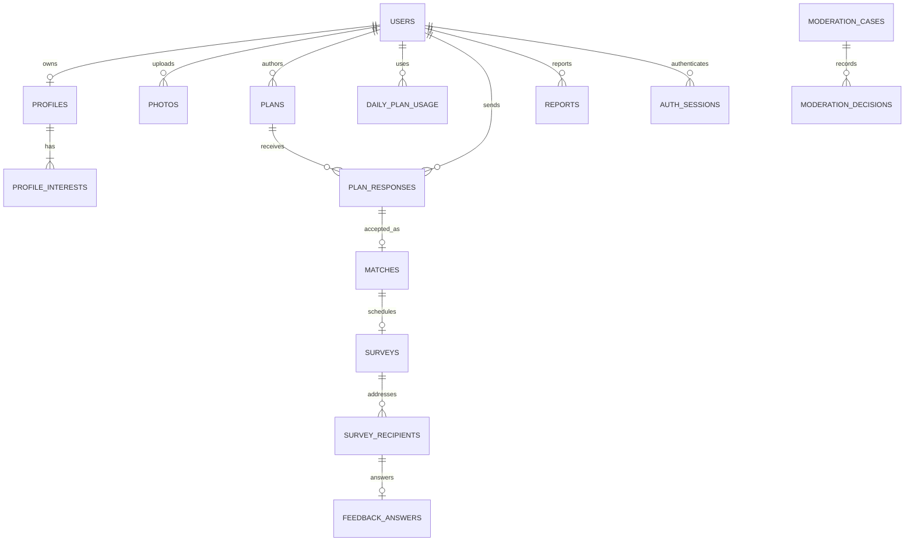

# Проект схемы PostgreSQL

Этап 4: **revision 0003, по-прежнему 29 таблиц**. [Миграция](../backend/migrations/versions/0003_user_plans.py) расширяет существующий CHECK publication_status значением cancelled и добавляет четыре неперсональные категории. Используются прежние plans/daily_plan_usage/idempotency_records, без повторных таблиц/пользователей. Атомарный расход 3 создаваемых записей в сутки Europe/Moscow и повтор POST описаны в [PLANS_STAGE4](PLANS_STAGE4.md). Создание черновика расходует квоту, отмена не возвращает; записи с откликами/мэтчами не изменяются и не удаляются по догадке. Следующие разделы 0001/0002 — предыдущие состояния схемы.

Актуальное дополнение этапов 3.3–3.4: **revision 0002, 29 таблиц**. [Миграция](../backend/migrations/versions/0002_telegram_profiles_and_private_media.py) добавляет media_deletions (устойчивая очередь файлов) и rate_limit_windows (технические лимиты), меняет profiles.age на BIGINT и заполняет только неперсональные справочники прежней формы. Возраст подтверждён как 18+ без продуктового максимума; три разных интереса проверяет транзакционный сервис. Серверные сессии, анкета/фото/удаление уже реализованы, не только описаны. Удаление аккаунта/фото/сессий не каскадирует будущую совместную историю: при её наличии 409 до любых изменений. Подробности и проверки — [TELEGRAM_AUTH](TELEGRAM_AUTH.md). Следующий раздел о 0001 описывает предыдущий этап.

Дата: 20.11.2026. **Схема реализована на этапе 3.2:** 27 SQLAlchemy-моделей/таблиц и явная Alembic revision `0001`. Источник точных типов/имён/DDL — [models](../backend/src/poidem/db/models/__init__.py) и [миграция](../backend/migrations/versions/0001_initial_schema.py). PostgreSQL 17, UUID/BIGINT/TIMESTAMPTZ, FK/UNIQUE/CHECK и частичный индекс слотов проверяются на настоящей тестовой БД. Неопределённые бизнес-правила имеют ссылки Bxx из [архитектуры](BACKEND_ARCHITECTURE.md#7-противоречия-и-решения-до-реализации). Сервисы расхода квот/согласий/модерации/рейтинга пока не реализованы: наличие таблицы не доказывает выполнение workflow. Результаты — [отчёт](BACKEND_IMPLEMENTATION.md).

Уточнения реализации: `plans.quota_charged_day` — отдельное поле DATE; `photos.bytes` отображается Python-атрибутом byte_size. Внешние ключи RESTRICT не удаляют историю каскадом. API-role лишена DDL, записи в справочники/alembic_version и изменения/удаления истории аудита/решений. У мигратора нет superuser/CREATEDB/CREATEROLE. Не установлены seed-факты о людях, шкала рейтинга, верхний возраст или выдуманные два этапа модерации. Минимум три интереса, подлинность согласий и политика расчёта остаются обязанностью будущих сервисов.

## 1. Общие правила

- UUID — внутренние PK; `telegram_user_id` и Telegram chat_id — BIGINT только в приватных таблицах. Username не является ключом пользователя
- Все технические timestamps — TIMESTAMPTZ/UTC; календарный день квоты — DATE из согласованной серверной IANA-зоны. Часовой пояс хоста/браузера не задаёт правило
- Поля version обновляются атомарно для защиты от устаревших решений/редактирования. created_at/updated_at и владельцев назначает сервер
- Real-данные не имеют флага is_demo: production не содержит fixture-записей. Для pytest/staging — отдельная БД. Допустимы только утверждённые неперсональные seed-справочники, не DEMO_PROFILE/DEMO_PLANS
- Не использовать SQLite как доказательство корректности PostgreSQL-блокировок, частичных индексов и конкурентных квот
- CHECK проверяет текущую строку, а не произвольные чужие строки; для связности используются FK/UNIQUE и транзакции. Составной FK должен ссылаться на подходящий уникальный ключ. См. [PostgreSQL constraints](https://www.postgresql.org/docs/17/ddl-constraints.html)

## 2. Сущности

Поля id/created_at опущены в таблице там, где они очевидны. Списки статусов — предлагаемые технические состояния, не выбранные два этапа модерации.

| Таблица | Основные поля | Ограничения и назначение |
| --- | --- | --- |
| `users` | id, telegram_user_id, private_username nullable, account_status, role_code, version, created_at | PK id, UNIQUE telegram_user_id и UNIQUE(id,telegram_user_id) для составного FK bot_bindings; предложены user/admin. Аккаунт не означает готовую анкету или доказанный возраст |
| `auth_sessions` | id, user_id, token_hash, csrf_token, authenticated_at, expires_at, last_seen_at, revoked_at | UNIQUE token_hash; FK users; сессионный cookie только в виде hash, не сырой cookie/initData. Случайный CSRF token хранится сервером для повторной выдачи своей сессии, не является самостоятельным средством входа |
| `photos` | id, owner_id, storage_key, media_type, bytes, width, height, processing_status, moderation_status, content_version | UNIQUE storage_key и UNIQUE(id,owner_id); приватный файл, отсутствие пользовательского pathname; размеры положительны |
| `profiles` | user_id, name, age BIGINT, gender_code, preference_code, bio, photo_id, moderation_status, version | PK/FK user_id; FK на справочники и составной FK(photo_id,user_id) → photos(id,owner_id). Целое 18+ без верхней продуктовой границы |
| `gender_options`, `preference_options` | code PK, title, enabled | Миграция 0002 добавляет варианты прежней формы; правила совместимости пока не реализованы |
| `interests` | code PK, title, enabled | Неперсональный утверждённый справочник |
| `media_deletions` | storage_key PK, created_at, attempts, next_attempt_at | Без FK к удаляемому пользователю; задача переживает удаление аккаунта, повтор файловой очистки после I/O ошибки/перезапуска |
| `rate_limit_windows` | key_hash PK, window BIGINT, attempts | Hash технического scope, attempts > 0, атомарный UPSERT; устаревшие окна очищаются |
| `profile_interests` | user_id, position, interest_code | PK(user_id,position), UNIQUE(user_id,interest_code), CHECK position между 1 и 3. Транзакционное полное сохранение проверяет ровно 3 |
| `categories` | code PK, title, cover_asset_key, enabled | Обложка только из утверждённых статических ресурсов; значение «Все планы» — фильтр UI, не категория БД |
| `plans` | id, author_id, title, category_code, starts_at, time_zone, place, description, publication_status, moderation_status, version, created_at, quota_charged_at/day nullable | FK users/categories; UNIQUE(id,author_id). Время и автор не доверяются клиентским служебным полям. Не создавать пока политику истечения/отмены B07 |
| `daily_plan_usage` | user_id, quota_day, used, calendar_zone, policy_version | PK(user_id,quota_day), CHECK 0 ≤ used ≤ 3. Zone/version — metadata, не новые части ключа, позволяющие обойти лимит |
| `plan_responses` | id, plan_id, plan_author_id, responder_id, agreed_plan_version, status, slot_no nullable, version, decision_actor_id nullable, decided_at nullable, created_at | FK responder_id/decision_actor_id → users; UNIQUE(plan_id,responder_id); составной FK(plan_id,plan_author_id) → plans; CHECK responder_id ≠ plan_author_id; свободные слоты 1–15. Версия согласия фиксируется после сверки с текущим планом под блокировкой |
| `matches` | id, response_id, plan_id, author_id, responder_id, accepted_plan_version, meeting_starts_at, meeting_time_zone, meeting_place, created_at | UNIQUE response_id; два NOT NULL различных user_id; составной FK к ровно соответствующему отклику. UNIQUE plan_id пока **не вводится** — B03 |
| `bot_bindings` | telegram_user_id PK, user_id nullable, private_chat_id, access_state, last_interaction_at | Привязка только из доверенного private update. Если user_id задан, составной FK(user_id,telegram_user_id) → users(id,telegram_user_id) |
| `moderation_cases` | id, target_user_id/profile_user_id/photo_id/plan_id nullable, object_version, workflow_version, state | Ровно один target, реальные FK. Тип/порядок этапов и разрешённые переходы — B06 |
| `moderation_decisions` | id, case_id, actor_id, step_key, action, reason, object_version, decided_at | Append-only история с административным actor. step_key не заполняется выдуманными stage1/stage2; нельзя одобрить другую версию |
| `reports` | id, reporter_id, reported_user_id/plan_id nullable, reason_code, comment, state, created_at | Ровно один target; FK к реальному объекту. Жалоба не меняет рейтинг/блокировку сама |
| `user_restrictions` | id, user_id, imposed_by, reason, imposed_at, lifted_at/by nullable | История ограничений; изменение user.account_status и аудит одной транзакцией. Срок/автоматическое снятие не выбираются до B06 |
| `surveys` | id, match_id, scheduled_at, meeting_context_version, state, policy_version | UNIQUE match_id для предложенного одного послематчевого опроса; переносы/повторные опросы требуют B07/B09 |
| `survey_recipients` | survey_id, participant_side, delivery_state, callback_token_hash, expires_at | PK(survey_id,participant_side), side только author/responder. Личность выводится из matches, не назначается callback-body |
| `feedback_answers` | survey_id, participant_side, met nullable, rating nullable, comment nullable, completion_state, submitted_at/updated_at | PK/FK → survey_recipients. По одной записи на каждого из ровно двух участников. Шкала/завершённость — B09 |
| `reliability_events` | id, subject_user_id, match_id nullable, kind, evidence_ref, verification_state, verified_by/at nullable, policy_version, source_event_key | UNIQUE source_event_key; факты/источник и подтверждение, а не назначенный клиентом score. Подтверждение — B10 |
| `notification_jobs` | id, kind, recipient_id, entity_ref, dedupe_key, due_at, state, attempts, next_attempt_at, lease_until, lease_owner, sent_at, telegram_message_id nullable, safe_error_code | UNIQUE dedupe_key; durable outbox/расписание. В payload нет сырого initData, сессионных ключей или контактов без прав |
| `telegram_updates` | bot_key, update_id, state, received_at/processed_at | PK(bot_key,update_id) против повторной обработки. Полный raw update не хранится без необходимости/политики B13 |
| `analytics_events` | id, event_key, event_type, actor_id nullable, entity_type/id, occurred_at, allowed_dimensions | UNIQUE event_key; allowlist полей, не произвольный JSON пользователя/копия анкеты |
| `admin_audit_log` | id, actor_id, action, target_ref, object_version, old/new_status, reason_code, request_id, occurred_at | Append-only административный аудит; без секретов и лишних копий текстов/фотографий |
| `idempotency_records` | actor_id, method, path, key, request_fingerprint, result_resource_ref, safe_result, expires_at | UNIQUE(actor_id,method,path,key); не хранить пароли, initData или image bytes как cached response |

Это не 25 сервисов: все таблицы — в одной БД, группировка в Python остаётся модульной. Необязательный CMS/избранное/групповые встречи/платежи не добавлены. Редакционные идеи пока могут оставаться статическими; отдельная таблица inspiration не нужна без решения об администрировании этого контента.

Индексы по FK и выдачам планируются отдельно от PK: plans(publication_status,starts_at,id), plans(author_id,created_at,id), responses(plan_id,status,created_at), responses(responder_id,created_at), matches(author_id,created_at) и matches(responder_id,created_at), jobs(state,next_attempt_at), reports(state,created_at), audit(actor_id,occurred_at). Состав/частичность уточнить через EXPLAIN на тестовых данных; не добавлять поисковый движок или все возможные индексы заранее.

## 3. Связи

Схема Mermaid показывает назначение, не все FK и не гарантию минимальной cardinality. Ровно три интереса и максимум два получателя проверяются правилами ниже.

## 4. Парность и согласие

1. `plans` имеет UNIQUE(id,author_id)
2. `plan_responses` хранит plan_author_id из плана, а не из JSON. Составной FK на plans и CHECK(responder_id <> plan_author_id) запрещают отклик автора даже при ошибке сервисного фильтра
3. В responses нужен UNIQUE(id,plan_id,plan_author_id,responder_id) для составной ссылки. `matches(response_id,plan_id,author_id,responder_id)` ссылается на этот ключ, поэтому нельзя подставить третьего человека/другой план
4. В matches фиксированы две NOT NULL колонки участников и CHECK(author_id <> responder_id). Таблицы произвольных списков участников нет
5. UNIQUE(response_id) не позволяет создать второй мэтч по тому же согласию. Единственность мэтча на весь plan_id зависит от B03, а не вытекает из парности

Действительное авторское согласие проверяет аутентифицированный сервис. Создание matches и перевод response waiting → accepted выполняются одной транзакцией после проверки actor==plan.author_id и согласованности agreed_plan_version с принимаемым контекстом. Изменение плана не означает нового согласия откликнувшегося; правила повторного согласия/переноса — B07. БД сама не доказывает, кто нажал кнопку; эти гарантии нельзя заменить одним FK. Решение о нескольких принятых откликах до B03 не выпускается в production.

Порядок блокировок одинаковый во всех сервисах: сначала plan, затем response, затем связанные записи. Это снижает взаимные блокировки. Повтор accept возвращает существующий match, а accept после decline требует явного правила/конфликта, не нового «согласия».

## 5. Транзакционные квоты

### Три создания за календарный день

Общие инварианты: подтверждённый аккаунт уникально связан с Telegram ID; время и quota_day вычисляет сервер; used не превышает 3. B04 определяет, когда запись плана становится расходующим квоту созданием — сейчас нельзя молча выбрать draft или publish.

После согласования события сервис в **одной** транзакции:

1. Проверяет actor/поля/контент/policy и ключ повтора
2. Атомарно создаёт дневную строку used=1 либо увеличивает существующую только при used<3 с возвратом результата; отсутствие увеличения означает конфликт лимита
3. Создаёт/изменяет план, помечает quota_charged_at/day ровно для выбранного события и сохраняет событие/outbox/idempotency result
4. При любой ошибке откатывает и расход, и ресурс. Повтор ключа не создаёт новый plan_id/расход

Атомарность UPSERT описана в [PostgreSQL INSERT](https://www.postgresql.org/docs/17/sql-insert.html#SQL-ON-CONFLICT). Простая последовательность COUNT → INSERT без блокировки не подходит. Счётчик не пересчитывается автоматически из оставшихся после удаления планов, иначе удаление стало бы обходом. Возврат квоты/удаление аккаунта и повторная регистрация требуют B04/B13; не реализовать «обнуление» по догадке. Время устройства и пропуски createdAt старых localStorage-записей на сервер не переносятся.

### Пятнадцать разных откликнувшихся

UNIQUE(plan_id,responder_id) сохраняет запрет повторного отклика независимо от статуса. Предлагается техническое резервирование `slot_no`: CHECK slot_no между 1 и 15 либо NULL, частичный UNIQUE(plan_id,slot_no) WHERE slot_no IS NOT NULL. Waiting всегда имеет слот. Получается не более 15 одновременно занятых слотов даже при гонке; автор не может занять слот благодаря связи выше.

Сервис блокирует plan, проверяет доступность/автора/существующий response, находит свободный слот и вставляет отклик. Conflict/откат не оставляет занятый слот. Нельзя полагаться на предварительный count из ответа клиенту.

**B05 не решён:** при запрете освобождения слот остаётся занятым и ограничивает исторических откликнувшихся; при разрешённом освобождении он может стать NULL после согласованного события, но сама response-запись остаётся для уникальности/истории. Это альтернативы, не выбранная реализация. До решения не добавлять автоматическое освобождение/списание по decline, блокировке или отмене.

## 6. Полнота анкеты, версии и модерация

`profiles` создаётся после полного сохранения формы: обязательные поля, принадлежащий пользователю photo_id, ровно три разных интереса. profile_interests ограничивает максимум тремя позициями; минимум три проверяет сервис в той же транзакции. Нельзя заявлять, что один CHECK считает строки другой таблицы. Publish/respond всегда повторно проверяют фактическую полноту, а не доверяют присланному profile_ready или устаревшему boolean.

Длина/18+ дублируются CHECK; API требует строго целый возраст и безопасное точное представление JavaScript. Верхний продуктовый предел явно не установлен пользователем: значение 2000 не отклоняется по возрастному максимуму. Это не проверка фактического возраста. Варианты gender/preference прежней формы и фото до 3 МиБ/16MP сохранены; правила совместимости и модерация требуют следующих этапов.

ModerationCase относится к ровно одному target и **конкретной версии**. Увеличение версии контента делает старое решение неприменимым к новой версии. Общий итоговый status не равен описанию двух стадий: workflow_version/step_key заполняются только после B06. Версию одобренного профиля/фото нельзя подменить новым непроверенным содержимым под прежним approved. Политику скрытия или сохранения последней одобренной версии необходимо выбрать явно.

Restriction хранит историю и автора действия. Редактирование account_status и аудит атомарны; автоматические сроки/восстановление старых публикаций после снятия ограничения не изобретаются.

## 7. Опросы, надёжность и фоновые задачи

`survey_recipients.participant_side` имеет только author/responder. В совокупности с PK это даёт максимум две строки; создание опроса вставляет обе в одной транзакции. Соответствующий user_id всегда выводится из matches. HTTP/callback не принимают сторону или чужой ID как доказательство права отвечать.

У answers тот же составной ключ. met=NULL/нет строки/незавершённый опрос не равны met=false. Конкретная обязательность рейтинга/комментария, его шкала, возможность исправления и срок — B09. Серверный статус подтверждённой встречи не выводится автоматически из одного ответа «Да» или наступившей даты.

ReliabilityEvent хранит источник/состояние подтверждения. Обычный response, молчание и неподтверждённая жалоба не создают негативное подтверждённое событие. Формула/снимок числового рейтинга и materialized aggregate до B10 не вводятся; при необходимости позже появится версионированный расчёт с возможностью воспроизведения.

Для jobs состояния proposed: pending/leased/sent/retry/failed/suppressed, короткий lease и индекс due jobs. Задача связывается с актуальной версией встречи; дальнейшие действия при переносе/отмене требуют B07. При ambiguous Telegram send после сбоя возможен внешний повтор, несмотря на UNIQUE dedupe_key. `telegram_updates` дедуплицирует обработку по update_id, а не требует бессрочно хранить сырой update.

## 8. Миграции, удаление и проверки

Предлагаемый порядок Alembic: users/sessions/справочники → photos/profiles/interests → plans/quota → responses/matches → moderation/reports/restrictions → bot/jobs/surveys/feedback → reliability events/analytics/audit/idempotency с учётом фактических FK. Таблицы идемпотентности и аудита должны быть доступны до первых соответствующих записей, а не добавлены после запуска реальных мутаций.

Миграции выполняются отдельным процессом с DDL-правами, runtime-role не является PostgreSQL superuser. Autogenerate — кандидат для ручной проверки; FK, CHECK, частичные индексы, данные и downgrade проверяются явно. Сроки хранения/очистка/анонимизация и действия FK при удалении утверждаются B13; по умолчанию не ставить каскадное уничтожение мэтчей/ответов/аудита вместе с анкетой.

Будущие pytest бизнес-сервисов на настоящей тестовой PostgreSQL: параллельные 4+ создания/16+ откликов, повтор одного ID, откат после расхода, UTC/границы суток, повтор/гонка accept, чужие ответы, устаревшая модерация и перезапуск leased job. Каждый проверяет HTTP-результат и конечное состояние БД после появления этих сервисов. Нынешние 62 проверки каркаса уже выполняют миграции и проверяют FK/UNIQUE/CHECK, автора/слоты, подмену третьего участника/фото, дедупликацию и роли. Они не доказывают работу ещё отсутствующих конкурентных бизнес-команд.
